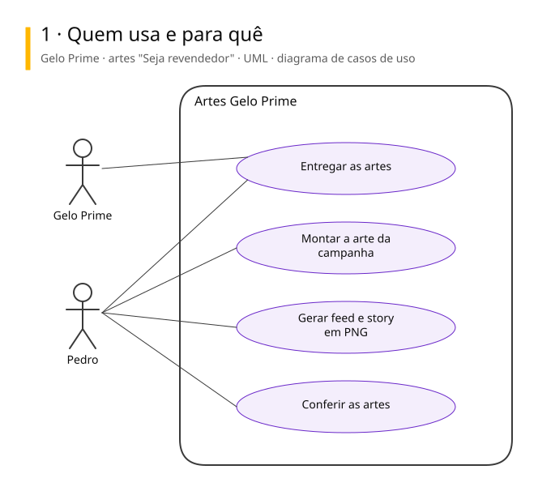
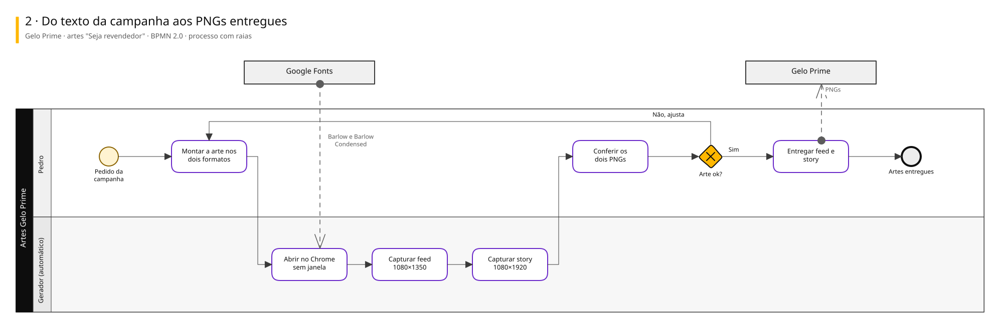
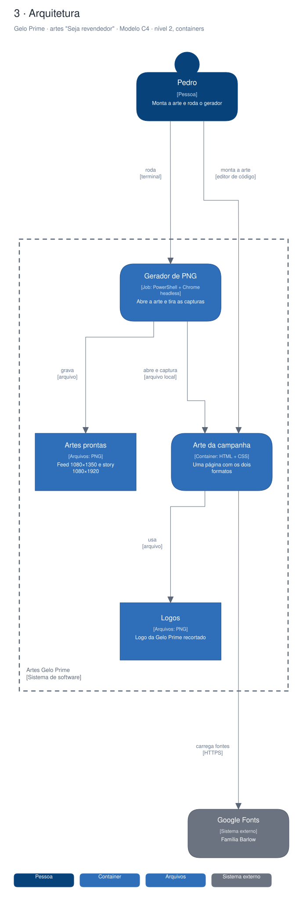

# Arquitetura

Diagramas gerados a partir do Sinapse (o segundo cérebro do Pedro). Cada projeto tem três vistas,
cada uma numa notação padrão:

1. **Quem usa e para quê**: UML, diagrama de casos de uso.
2. **O processo principal**: BPMN 2.0, com raias por quem executa.
3. **A arquitetura**: modelo C4, nível 2 (containers).

## Gelo Prime · artes "Seja revendedor"

Duas artes da campanha "Seja um revendedor Gelo Prime! Nós fornecemos o freezer", em feed e story. Saem de uma única página renderizada pelo Chrome sem janela, num script de PowerShell. Entregues em 01/10/2026.

### Quem usa e para quê (UML)

### Do texto da campanha aos PNGs entregues (BPMN 2.0)

### Arquitetura (C4, containers)

Editável: [`gelo-prime.excalidraw`](./gelo-prime.excalidraw), abre em [excalidraw.com](https://excalidraw.com) ou no VS Code com a extensão Excalidraw.

A fonte destes arquivos é o vault do Sinapse (`09-DESENHOS/`); alterações feitas aqui são sobrescritas na próxima publicação.
